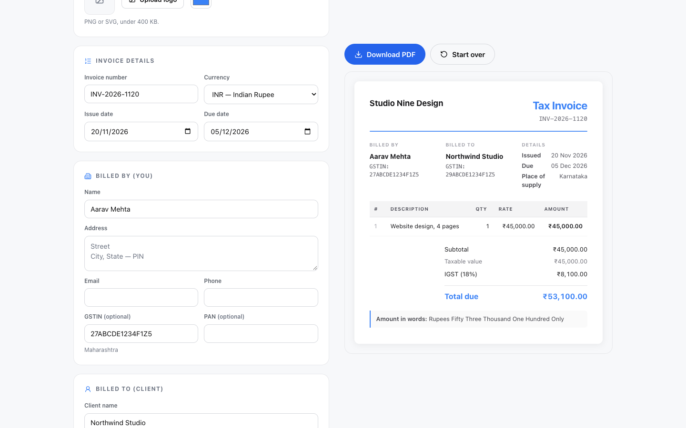

# Invoice Generator

A free, private, GST-ready invoice generator. It runs entirely in your browser: there is no server, no account and no watermark, and your client details never leave your device.

**Live: [invoice.freelysta.com](https://invoice.freelysta.com)**



## Features

- **GST for India:** CGST + SGST for same-state supply, IGST for different states. The state is read from the two GSTINs, with a manual override. GSTIN format is validated, and the place of supply is shown on the invoice.
- **Eight currencies:** INR, USD, GBP, EUR, AUD, CAD, AED, SGD. Amounts are never converted.
- **Amount in words:** Indian grouping (lakh, crore) for INR, western grouping for the rest.
- **Branding:** your logo, accent colour and business name.
- **Discount and tax:** percent or flat discount, GST, or any named tax such as VAT.
- **Payment details:** bank account, IFSC and UPI on the invoice.
- **PDF output:** uses the browser's print pipeline. The PDF has real, selectable text and proper page breaks, and the library adds no dependencies for it.
- **Private by design:** drafts and the last few invoices are kept in `localStorage` on your device.

## Run it

```bash
npm install
npm run dev      # http://localhost:5173
npm test         # unit tests for the totals, GST and amount-in-words maths
npm run build    # static site in dist/
```

The build is a plain static site. Host `dist/` anywhere: GitHub Pages, Netlify, Cloudflare Pages, an S3 bucket or nginx.

## How it is organised

| Path | What it does |
|---|---|
| `src/lib/invoiceModel.js` | Pure data model and maths: totals, discounts, GST split, amount in words, local persistence. No React. |
| `src/lib/currencies.js` | The supported currencies. Add one here to support more. |
| `src/components/InvoiceDocument.jsx` | The printable A4 invoice sheet. Pure presentation. |
| `src/App.jsx` | The form, the live preview and the print flow. |
| `src/styles.css` | All styles, including the `@media print` rules. |
| `test/` | Vitest tests for the model. |

### Adding a currency

1. Add an entry to `CURRENCIES` in `src/lib/currencies.js`.
2. Add its major and minor unit names to `MAJOR_UNIT` and `MINOR_UNIT` in `src/lib/invoiceModel.js`, so the amount in words reads correctly.
3. Add a test.

## Notes

- This tool lays out an invoice. It does not file taxes or give tax advice. Check GST rates and rules with your accountant.
- Clearing your browser's site data removes the saved draft.

## Contributing

Issues and pull requests are welcome. Please run `npm test` and `npm run build` before opening a PR, and add a test for any change to the maths.

## License

[MIT](LICENSE) © AINOR
